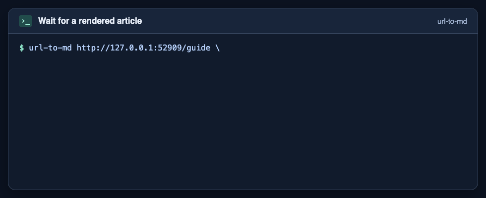
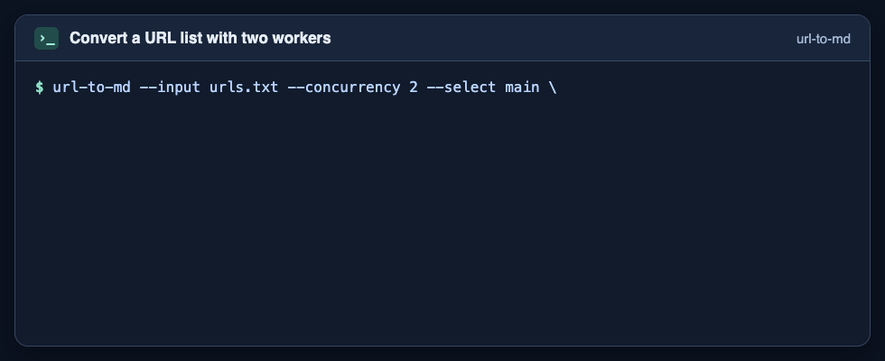

# url-to-markdown-cli-tool

A Node.js CLI tool that converts web pages into clean, LLM-friendly markdown format. It fetches web content using Puppeteer and strips away noise like ads, navigation elements, and unnecessary formatting, leaving you with properly formatted markdown that's perfect for feeding into large language models, RAG systems, or AI training datasets. 

No LLM or API keys required.

**Key features:**
- 🔄 Convert any webpage to properly formatted markdown with headers, links, and structure
- 🎯 **Targeted content extraction** - Select an article, HTML tags, or elements matching CSS selectors
- 🧹 **Smart content cleaning** - Remove navigation, footers, scripts and other non-content elements
- 🚫 Remove images, links, or specific HTML tags as needed
- 📊 **Enhanced table conversion** - HTML tables become clean markdown tables with pipes and headers
- 📱 **Viewport control** - Mobile, tablet, desktop viewports for responsive content extraction
- ⏱️ Wait for a CSS selector to appear on a JavaScript-rendered page
- 📚 Convert URL lists from a file or stdin with bounded concurrency and per-URL results
- 👁️ Headless or visible browser modes for debugging
- 📦 Easy npm installation with global CLI access
- 🧠 Clean output optimized for LLM parsing and understanding
- ⚡ Fast Node.js implementation with Puppeteer browser automation

## Quick Install

```bash
npm install -g url-to-markdown-cli-tool
```

Then immediately get started:
```bash
url-to-md https://example.com -o example.md
```

## Installation

### Via npm (When published)

```bash
# Install globally to use anywhere
npm install -g url-to-markdown-cli-tool

# Or install locally in your project
npm install url-to-markdown-cli-tool
```

### From Source (Current)

```bash
# Clone and install from this repository
git clone https://github.com/mmdclx/url-to-markdown-cli-tool.git
cd url-to-markdown-cli-tool
npm install
npm install -g .
```

### System Requirements

- **Node.js** 22.12.0 or higher
- **Chrome for Testing**, downloaded by Puppeteer during installation

Set `PUPPETEER_EXECUTABLE_PATH` to use a compatible Chrome installation instead.

## Usage

```bash
# Convert a webpage to markdown file
url-to-md https://example.com -o example.md

# Smart content cleaning - removes nav, footer, aside, script, style, header, noscript, canvas
url-to-md https://blog.example.com --clean-content -o clean-blog.md

# Output to console
url-to-md https://example.com

# Get help
url-to-md --help
```

### Article Mode and CSS Selectors

Use `--article` to extract the article with the most text. It falls back to the main landmark and then the page body. It removes navigation, sidebars, and footers while keeping the article heading.

Use `--select` to keep elements matching your CSS selectors. Repeat the option or pass a comma-separated selector list. Matches stay in page order, and a matching descendant appears once inside its selected ancestor. Use `--remove-selector` to remove elements before extraction.

```bash
url-to-md https://example.com/guide --article -o guide.md

url-to-md https://example.com/docs \
  --select 'main > .guide' \
  --select '#reference' \
  --remove-selector '.advertisement' \
  -o docs.md
```

Choose one of `--article`, `--select`, or `--include-tags` for each run. The removal options can be combined with any of them.

### Waiting for JavaScript Content

`--wait-for` captures the page when the CSS selector matches an element. The default selector timeout is 30 seconds. Use `--wait-for-timeout` to override it. A timeout exits with status 1. If you also pass `--wait`, that delay runs before the selector check.

Each URL has a 60-second capture deadline covering DNS, browser startup, navigation, waits, and HTML capture. Use `--capture-timeout` to set a shorter deadline in seconds. A deadline failure in batch mode appears in that URL's result.

Captured HTML is limited to 5 MiB in UTF-8 before Markdown conversion. An oversized page returns an error for that URL.

```bash
url-to-md https://example.com/guide \
  --wait-for 'article.post' --wait-for-timeout 15 --article
```



The demo uses a local fixture and passes `--allow-private-network` to permit that origin.

### Targeted Content Extraction by Tag
```bash
# Extract only article content (perfect for news sites and blogs)
url-to-md https://news-site.com --include-tags article -o article.md

# Extract main content areas (common for documentation and blogs)
url-to-md https://blog.com --include-tags main section article -o content.md

# Combine targeted extraction with cleanup (remove ads within articles)
url-to-md https://news.com --include-tags article --remove-tags aside nav -o clean-article.md

# Extract specific sections from documentation
url-to-md https://docs.example.com --include-tags main section -o docs.md
```

#### How Include-Tags and Remove-Tags Work Together

The `--include-tags` and `--remove-tags` flags can be combined for powerful content filtering:

1. **Include-tags first**: Only content within specified tags is processed
2. **Remove-tags second**: Specified tags are removed from the included content
3. **Priority rule**: If a tag appears in both lists, include-tags takes precedence

```bash
# Example: Extract article content but remove ads and navigation within it
url-to-md https://news-site.com \
  --include-tags article \
  --remove-tags aside nav .advertisement \
  -o clean-article.md
```

### Content Filtering
```bash
# Smart content cleaning - removes nav, footer, aside, script, style, header, noscript, canvas
url-to-md https://blog.example.com --clean-content -o clean-blog.md

# Remove all images
url-to-md https://blog.example.com --no-images -o clean-blog.md

# Remove webpage links (keep text, remove hyperlinks)
url-to-md https://article.com --no-links -o text-only.md

# Remove specific image types
url-to-md https://site.com --no-gif-images --no-svg-images

# Remove specific HTML tags manually
url-to-md https://site.com --remove-tags nav footer aside script
```

### Viewport Configuration
```bash
# Use mobile viewport for responsive sites (375x667 - iPhone)
url-to-md https://example.com --mobile -o mobile-view.md

# Use tablet viewport (768x1024 - iPad portrait)
url-to-md https://example.com --tablet -o tablet-view.md

# Use desktop viewport (1920x1080 - standard desktop)
url-to-md https://example.com --desktop -o desktop-view.md

# Custom viewport dimensions
url-to-md https://example.com --viewport-width 1200 --viewport-height 800 -o custom-view.md
```

### Advanced Options
```bash
# Debug with visible browser to see content loading
url-to-md https://dynamic-site.com --show-browser --wait 5.0

# Maximum cleanup with targeted extraction
url-to-md https://article.com \
  --include-tags article main \
  --clean-content \
  --no-images \
  --no-links \
  --wait 3.0 \
  -o clean-article.md

# Extract article content with mobile viewport (great for responsive sites)
url-to-md https://news-site.com \
  --include-tags article \
  --mobile \
  --clean-content \
  -o mobile-article.md

# Convert a page from a trusted local development server
url-to-md http://localhost:3000 --allow-private-network
```

The browser accepts HTTP(S) URLs and blocks non-public destinations by default, including for redirects and subresources. `--allow-private-network` permits private or loopback addresses only for the requested origin. Link-local and reserved addresses remain blocked. Use a worker with OS-level network isolation if you expose this CLI to untrusted users.

### Batch Processing & Automation

Create a text file with one URL per line. Blank lines and lines starting with `#` are skipped. Use `--input -` to read the same format from stdin.

```bash
# From a file
url-to-md --input urls.txt --concurrency 2 --article > results.jsonl

# From stdin
printf '%s\n' 'https://example.com/' 'https://www.iana.org/help/example-domains' \
  | url-to-md --input - --select main > results.jsonl

# Print the Markdown from successful records
jq -r 'select(.ok) | .markdown' results.jsonl
```

Batch mode runs up to 3 conversions at once by default. Set `--concurrency` to an integer from 1 to 8. Each completed conversion writes a JSON Lines record to stdout, so records can arrive out of input order. The `line` field identifies the original input line, including skipped lines in the numbering.

```jsonl
{"line":1,"url":"https://example.com/","ok":true,"markdown":"# Example Domain"}
{"line":2,"url":"https://example.com/missing","ok":false,"error":"Error while fetching page: HTTP 404 for https://example.com/missing"}
```

Batch mode finishes the remaining URLs after individual failures and exits with status 1 if any URL fails. Redirect stdout to save the JSON Lines file. For a single URL, `-o` writes Markdown, and an HTTP 4xx or 5xx response for the main page reports the status and URL on stderr and exits with status 1.



## Full Command Line Options

```
Usage: url-to-md [options] [url]

Fetch URL content and output LLM-friendly markdown

Arguments:
  url                              URL to fetch

Options:
  -V, --version                    output the version number
  -i, --input <file>               Read URLs from a file or stdin (-) and write JSON Lines
  --concurrency <count>            Batch concurrency from 1 to 8 (default: 3)
  -o, --output <file>              Write Markdown for a single URL to a file
  --no-links                       Remove webpage links from the output
  --no-images                      Remove images from the output
  --no-gif-images                  Remove GIF images from the output  
  --no-svg-images                  Remove SVG images from the output
  --clean-content                  Remove common non-content tags (nav, footer, aside, script, style, header, noscript, canvas)
  --article                        Extract the main article or page content
  --select <selector>              Keep matches for a CSS selector (repeatable)
  --remove-selector <selector>     Remove matches for a CSS selector (repeatable)
  --include-tags <tags...>         Include only specific HTML tags and their content (e.g., --include-tags article main section)
  --remove-tags <tags...>          Remove specific HTML tags (e.g., --remove-tags div span)
  --wait <seconds>                 Extra delay (default: 1.5, or 0 with --wait-for)
  --wait-for <selector>            Wait for a CSS selector to match an element
  --wait-for-timeout <seconds>      Selector timeout (default: 30)
  --capture-timeout <seconds>       Total capture timeout (default and maximum: 60)
  --show-browser                   Show browser window (visible mode)
  --mobile                         Use mobile viewport (375x667 - iPhone)
  --tablet                         Use tablet viewport (768x1024 - iPad portrait)
  --desktop                        Use desktop viewport (1920x1080 - standard desktop)
  --viewport-width <width>         Set viewport width in pixels (320-1920, default: 375)
  --viewport-height <height>       Set viewport height in pixels (568-1080, default: 667)
  --allow-private-network          Allow private or loopback addresses for the requested origin
  -h, --help                       display help for command
```

## Troubleshooting

### Content Not Fully Extracted?

Many modern websites use **JavaScript to load content dynamically** after the initial page loads. If you're only seeing partial content, loading spinners, or placeholder text, the website likely renders its main content using JavaScript.

**Solutions:**

1. **Wait for the content selector** if you know which element will appear:
   ```bash
   url-to-md https://spa-app.com --wait-for '#results' --wait-for-timeout 15
   ```

2. **Debug with visible browser** to see what's happening:
   ```bash
   # Watch the page load in a visible browser window
   url-to-md https://dynamic-site.com --show-browser --wait 5.0
   ```

### Common Issues

#### "Permission denied" errors
```bash
# On Linux/macOS, make sure the binary is executable
chmod +x /usr/local/bin/url-to-md

# Or reinstall globally
npm uninstall -g url-to-markdown-cli-tool
npm install -g url-to-markdown-cli-tool
```

#### Network timeout errors
```bash
# Increase wait time for slow networks
url-to-md https://example.com --wait 10.0
```

## Use Cases

### 🤖 AI & Machine Learning
- **Training Data**: Extract clean text from web articles for LLM training
- **RAG Systems**: Convert documentation and articles for vector databases  
- **Content Curation**: Batch process URLs for AI content pipelines
- **Structured Data**: Extract tables and structured content in markdown format

### 📚 Documentation & Research
- **Knowledge Base**: Convert external docs to consistent markdown format
- **Research**: Extract academic papers and articles for analysis
- **Archival**: Preserve web content in clean, readable format

### 🔄 Content Migration
- **CMS Migration**: Extract content from old websites
- **Documentation Sites**: Convert existing content to markdown-based docs
- **Static Site Generation**: Process dynamic content for static sites

**Perfect for:** RAG systems, LLM training data preparation, documentation extraction, table data extraction, and any workflow that needs clean, structured text from web content.


## Acknowledgments

- Originally inspired by [m92vyas/llm-reader](https://github.com/m92vyas/llm-reader), a Python library
- Built with [Puppeteer](https://pptr.dev/) for reliable browser automation
- Uses [Cheerio](https://cheerio.js.org/) for server-side HTML manipulation
- Powered by [Turndown](https://github.com/mixmark-io/turndown) for HTML to Markdown conversion

---

